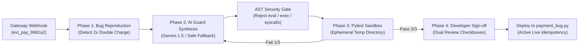

# PayPatch AI — Autonomous Payment Backend & Idempotency Agent

[](https://www.python.org/)
[](https://react.dev/)
[](https://docs.pytest.org/)
[](https://fastapi.tiangolo.com/)
[](https://opensource.org/licenses/MIT)

> **Autonomous AI coding agent for mission-critical payment gateways.** Analyzes duplicate webhook vulnerabilities, synthesizes AST-validated idempotency guards, executes real-time Pytest regression test sandboxes, and enforces a zero-trust human approval gate.

---

## 1. Problem Statement

Payment gateways (such as **Stripe, Adyen, Razorpay, and PayPal**) guarantee *at-least-once* delivery for webhook events. In scenarios involving:
- Network packet loss or high server response latency (>5000ms),
- Automatic gateway retry storms, or
- Concurrent multi-region delivery retries,

the exact same webhook event ID (e.g. `evt_pay_9981a2`) can be delivered multiple times.

If the backend webhook handler lacks atomic idempotency protection, it commits the payment operation repeatedly. **Consequences:**
- Customers are double-charged ($149.00 becomes $298.00).
- Fulfillment orders and warehouse inventory are dispatched twice.
- Severe financial reconciliation anomalies, merchant chargeback fines, and loss of consumer trust.

---

## 2. Solution: PayPatch AI

PayPatch AI is an automated coding agent designed for payment reliability engineering:
1. **Reproduce Vulnerability:** Dispatches simulated duplicate webhook events through `payment_bug.py` to trigger and prove the duplicate transaction anomaly.
2. **Synthesize Idempotency Guard:** Uses generative AI (Google Gemini / OpenAI / Groq) with an automated AST safety boundary (or a deterministic safe fallback patch) to synthesize a deduplication layer.
3. **Isolated Pytest Sandbox:** Mounts candidate patches into an ephemeral temporary sandbox directory and executes real pytest regression tests under strict timeouts. Never claims a patch works without authentic test execution logs.
4. **Human Review & Approval Gate:** Developers review side-by-side unified code diffs and test evidence before explicitly approving and deploying changes to disk.

---

## 3. Product Architecture



---

## 4. Visual Design Identity

PayPatch AI is engineered with a **luxury dark developer aesthetic**:
- **Obsidian Black (`#111110`)**: Deep immersive background.
- **Graphite (`#242321`)**: Surfaces, cards, and microservice borders.
- **Champagne Gold (`#D6B779`)**: Accent highlights, primary actions, and brand badges.
- **Warm Ivory (`#F5F0E7`)**: High-contrast, accessible typography.
- **Muted Taupe (`#A49A89`)**: Secondary metadata, technical labels.
- **Restrained Green (`#10B981`)**: Verified passing tests and idempotent state.
- **Restrained Red (`#EF4444`)**: Detected duplicate ledger anomalies and test failures.

Featuring an **interactive 3D Three.js canvas** representing the autonomous idempotency shield core and orbiting webhook transaction particles.

---

## 5. Technology Stack

- **Backend & Logic:** Python 3.10+
- **REST API:** FastAPI + Uvicorn ASGI server (`server.py`)
- **Automated Regression Testing:** Pytest 9.1 (`test_payment_bug.py`)
- **Interactive Web App:** React 19 + TypeScript + Vite + Tailwind CSS + Three.js (`App.tsx`)
- **Executive Review Dashboard:** Streamlit (`app.py`)
- **AST Security Validator:** Python `ast` module (static syntax and restricted-call analysis)
- **Code Diff Engine:** Python `difflib` unified diff engine

---

## 6. Getting Started (Windows)

### Prerequisites
- Python 3.10 or higher (`python --version`)
- Node.js 18+ and npm (`npm --version`)

### Step 1: Install Python Dependencies
```powershell
pip install -r requirements.txt
```

### Step 2: Install Frontend Dependencies
```powershell
npm install
```

### Step 3: Run the Complete Full-Stack Application

Open two terminal windows:

**Terminal 1 — Python Backend API Server:**
```powershell
python server.py
```
*API server will launch on `http://127.0.0.1:8000` with Swagger documentation at `/docs`.*

**Terminal 2 — React 3D Web Application:**
```powershell
npm run dev
```
*Frontend will launch on `http://localhost:5173`.*

---

### Alternative: Streamlit Interactive Dashboard
If you prefer running the single-process Streamlit dashboard:
```powershell
streamlit run app.py
```
*The Streamlit dashboard opens automatically on `http://localhost:8501`.*

---

## 7. Verification & Automated Test Suite

You can execute the automated test suite directly via the command line:

### Test Buggy Version (Demonstrating Duplicate Failure):
```powershell
python -m pytest test_payment_bug.py -v
```
**Expected Output:**
```text
test_payment_bug.py::test_first_webhook_event_processed_successfully PASSED [ 33%]
test_payment_bug.py::test_duplicate_webhook_event_does_not_duplicate_ledger FAILED [ 66%]
test_payment_bug.py::test_different_webhook_events_processed_successfully PASSED [100%]

================================== FAILURES ===================================
AssertionError: CRITICAL FAILURE: Duplicate webhook event_id 'evt_test_dup_001' caused duplicate ledger entry! Expected 1 entry, found 2. Double charging / double fulfillment occurred.
========================= 1 failed, 2 passed in 0.58s =========================
```

---

## 8. Safety & Enterprise Production Architecture

### Security Boundaries
1. **AST Validation:** Candidate code is parsed with `ast.parse()`. Any invocation of `eval`, `exec`, `subprocess`, `os.system`, or unauthorized network I/O is rejected before execution.
2. **Ephemeral Sandbox:** Test execution takes place inside a temporary directory (`tempfile.TemporaryDirectory()`) with strict execution timeouts.
3. **Simulated Payments Only:** Zero interaction with real credit cards or live banking networks.

### In-Memory vs. Production Idempotency
- **Prototype Mode:** Uses a thread-safe Python set `_processed_event_ids: set[str]` for local verification and regression testing.
- **Enterprise Distributed Mode:** Real payment gateways require persistent, distributed atomicity:
  - **Redis `SETNX`:** `SET idemp:evt_9981a2 1 NX EX 86400` ensures atomic check-and-set across multi-pod Kubernetes clusters.
  - **Relational Unique Constraint:** `CONSTRAINT uk_event_id UNIQUE (event_id)` in PostgreSQL guarantees ACID database-level conflict rejection.
  - **Distributed Redlock:** Two-phase locking across multi-region active-active clusters.

---

## 9. Hackathon MVP Limitations & Roadmap

| Current Prototype | Enterprise Roadmap |
| :--- | :--- |
| In-memory deduplication set | Redis Cluster + PostgreSQL unique key storage |
| Single webhook handler (`payment_bug.py`) | Distributed multi-service webhook routing (Kafka / SQS) |
| Local file patch deployment | Automated GitHub Pull Request & CI/CD pipeline integration |
| Pytest unit assertions | Load testing with 10,000 concurrent simulated duplicate retries |

---

## 10. License
MIT License. Created for the Hackathon Demonstration.
